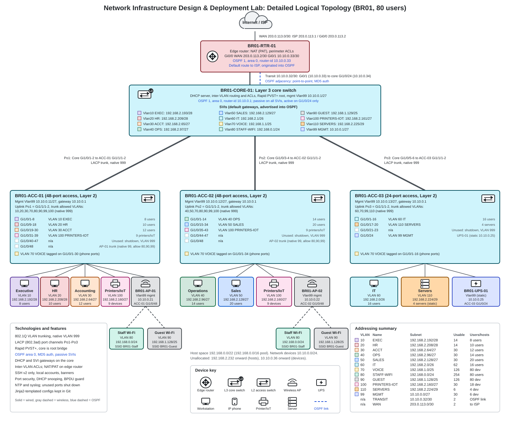

# Network Infrastructure Design & Deployment Lab

A virtual two-building office network project covering the full deployment lifecycle: VLAN/IP design, switch and wireless configuration, staging, testing, troubleshooting, and as-built documentation.

> **Status:** In progress. Sections marked *(pending)* are filled in as each phase is completed.

> **Note:** This is a simulated environment built in Cisco Packet Tracer. No physical equipment was used. All device names, IP addresses, serial numbers, and asset tags are fictional.

## Overview

This project simulates the rollout of a two-building office network. Building 1 is a new 80-person office with six departments (Executive, HR, Accounting, Operations, Sales, and IT). Building 2 is a small satellite with one department (Logistics, 20 people) joined to Building 1 by a routed link, with its internet access provided through Building 1. I took the role of the deployment technician responsible for planning, staging, configuring, testing, and documenting the site's network infrastructure against a defined set of naming, labeling, security, and documentation standards.

The goal is to practice the work of a real infrastructure deployment, not just a working configuration: pre-deployment planning, standardized configs, evidence-based testing, troubleshooting, and a handoff package another technician could use to support the site.

## Skills demonstrated

- Ethernet, TCP/IP, switching, VLANs, IP addressing, and subnetting
- 802.1Q trunking, LACP/EtherChannel uplinks, inter-VLAN routing, and OSPF dynamic routing
- Switch baseline hardening: SSH-only management, port security, DHCP snooping, BPDU guard, unused-port shutdown, native VLAN change
- Wireless deployment with SSIDs mapped to VLANs
- Multi-building design: inter-building routed link, OSPF across three routing devices, router-on-a-stick, and shared NAT
- Staging workflow: inventory, labeling, config templates, and checklists
- Configuration as code: Jinja2 templates and variables kept in Git
- Rack, patch panel, cabling, and UPS planning
- Test planning and evidence collection
- Structured troubleshooting and root-cause documentation
- Project planning, vendor and contractor coordination, and technical documentation

## Tools

| Purpose | Tool |
|---|---|
| Network simulation | Cisco Packet Tracer |
| Diagrams | draw.io (diagrams.net) |
| Inventory, port map, test matrix, BOM | Excel / Google Sheets |
| Config templating | Python, Jinja2 |
| Version control and documentation | Git, GitHub, Markdown |

## Network design

Addressing is allocated with VLSM from two pools: `192.168.0.0/16` for hosts (summarized as `192.168.0.0/22`) and `10.10.0.0/24` for network devices. Each subnet is sized from its department's headcount plus 25% growth and a gateway address. The method, DHCP conventions, routing design, per-switch port plan, and inter-VLAN policy are in [`Planning/addressing-plan.md`](Planning/addressing-plan.md).

**Topology:** two buildings. Building 1 has one edge router, one Layer 3 core switch, three access switches (Executive/HR/Accounting, Operations/Sales, and IT/servers), and two wireless APs. Each access switch connects to the core with a two-link LACP port channel. Building 2 is a small satellite with one router (BLD2-RTR-01) and one access switch serving one department, Logistics. A routed point-to-point link joins the two buildings, and the core, the edge router, and the Building 2 router all run OSPF (area 0). Building 2 has no ISP connection: its internet traffic crosses the link and is translated by the Building 1 edge router. Native VLAN 999 is unused and not routed.

**Host VLANs (192.168.0.0/16)**

| VLAN | Name | Users / hosts | Subnet | Usable |
|---|---|---|---|---|
| 10 | EXEC | 8 users | 192.168.2.192/28 | 14 |
| 20 | HR | 10 users | 192.168.2.208/28 | 14 |
| 30 | ACCT | 12 users | 192.168.2.64/27 | 30 |
| 40 | OPS | 14 users | 192.168.2.96/27 | 30 |
| 50 | SALES | 20 users | 192.168.2.128/27 | 30 |
| 60 | IT | 16 users | 192.168.2.0/26 | 62 |
| 70 | VOICE | 80 devices | 192.168.1.0/25 | 126 |
| 80 | STAFF-WIFI | 80 users | 192.168.0.0/24 | 254 |
| 90 | GUEST | 80 devices | 192.168.1.128/25 | 126 |
| 100 | PRINTERS-IOT | 18 devices | 192.168.2.160/27 | 30 |
| 110 | SERVERS | 4 devices | 192.168.2.224/29 | 6 |
| 120 | LOGISTICS | 20 users | 192.168.3.0/27 | 30 |

**Network device addressing (10.10.0.0/24)**

| Segment | Subnet | Usable | Purpose |
|---|---|---|---|
| VLAN 99 MGMT | 10.10.0.0/27 | 30 | Building 1 switch, AP, and UPS management (gateway 10.10.0.1) |
| Transit | 10.10.0.32/30 | 2 | Edge router (10.10.0.33) to core (10.10.0.34), routed link running OSPF |
| WAN | 203.0.113.0/30 | 2 | ISP handoff (placeholder documentation range), router 203.0.113.2 |
| Inter-building transit | 10.10.0.36/30 | 2 | BLD1-RTR-01 (10.10.0.37) to BLD2-RTR-01 (10.10.0.38), routed link running OSPF |
| VLAN 99 MGMT (Building 2) | 10.10.0.40/29 | 6 | BLD2-ACC-01 management (gateway 10.10.0.41 on BLD2-RTR-01) |

**Devices**

| Device | Role | Management / transit IP |
|---|---|---|
| BLD1-RTR-01 | Edge router: NAT, OSPF, default route to ISP, link to Building 2 | 10.10.0.33 (core), 10.10.0.37 (BLD2), 203.0.113.2 (WAN) |
| BLD1-CORE-01 | Layer 3 core switch: DHCP, SVIs, inter-VLAN routing, OSPF | 10.10.0.1 (VLAN 99), 10.10.0.34 (transit) |
| BLD1-ACC-01 | Access switch (Executive, HR, Accounting, Printers/IoT) | 10.10.0.11 |
| BLD1-ACC-02 | Access switch (Operations, Sales, Printers/IoT) | 10.10.0.12 |
| BLD1-ACC-03 | Access switch (IT, Servers, UPS) | 10.10.0.13 |
| BLD1-AP-01 / AP-02 | Wireless APs (Staff and Guest SSIDs) | 10.10.0.21 / 10.10.0.22 |
| BLD1-UPS-01 | UPS network card | 10.10.0.25 |
| BLD2-RTR-01 | Building 2 router: DHCP, router-on-a-stick, OSPF | 10.10.0.38 (inter-building), 10.10.0.41 (VLAN 99), 192.168.3.1 (VLAN 120) |
| BLD2-ACC-01 | Building 2 access switch (Logistics) | 10.10.0.42 |

**Standards**

- Device naming: `SITE-ROLE-NN` (for example `BLD1-ACC-01`)
- Cable and port labels: `SITE-IDF#-PP#-PORT` (for example `BLD1-IDF1-PP1-14`)
- Patch cable colors assigned by function
- Security baseline applied to every device from one config template

## Technologies and configuration approach

- **Platform:** Cisco Packet Tracer using Cisco IOS-style CLI. The same design can be rebuilt in GNS3 or EVE-NG with real IOS images.
- **Routing:** OSPFv2, single area (area 0), across the Building 1 core switch, the Building 1 edge router, and the Building 2 router. Point-to-point network type, MD5 authentication, passive interfaces on every user-facing SVI, and a default route originated by the edge router. Inter-VLAN routing happens on the core through SVIs in Building 1 and on router subinterfaces (router-on-a-stick) in Building 2.
- **How devices are configured:** the Cisco IOS command line, first over console, then over SSH on the management VLAN. Configs are written as Jinja2 templates with per-device variables stored in the repo, rendered per device by a short Python script, applied during staging, then verified with `show` commands and committed.
- **Automation (optional, later):** Netmiko or Ansible (`cisco.ios` collection) can push the rendered configs to GNS3 or EVE-NG devices. Packet Tracer devices cannot be driven from the host, so configs are pasted there.
- **Protocols and features:** 802.1Q VLAN trunking, LACP port channels, Rapid PVST+, OSPF, DHCP on the core, inter-VLAN ACLs, NAT/PAT, SSH v2, port security, DHCP snooping, BPDU guard, NTP, and syslog.

## Project phases

| Phase | Focus | Folder | Status |
|---|---|---|---|
| 0 | Repo and tool setup | root | Complete |
| 1 | Requirements, IP/VLAN plan, standards, logical diagram | `Planning/` | In progress |
| 2 | Site survey, BOM, inventory, rack elevation, UPS sizing, project plan, checklists | `Pre-deployment/` | Pending |
| 3 | Build the virtual topology | `Configs/` | Pending |
| 4 | Config template and device staging | `Configs/` | Pending |
| 5 | Wireless configuration | `Configs/` | Pending |
| 6 | Testing | `Testing/` | Pending |
| 7 | Troubleshooting log | `Troubleshooting/` | Pending |
| 8 | Coordination documents | `Coordination/` | Pending |
| 9 | Handoff package | `Handoff/` | Pending |
| 10 | Final README, release, and publish | root | Pending |

## Testing summary *(pending)*

Results are added after Phase 6, for example: "XX of XX tests passed on the first run; YY required fixes (see the troubleshooting log)."

## Troubleshooting highlights *(pending)*

| # | Symptom | Root cause | Fix |
|---|---|---|---|
| 1 | | | |
| 2 | | | |
| 3 | | | |

## How to reproduce *(pending)*

1. Install Cisco Packet Tracer.
2. Open `Configs/network-infrastructure-design-deployment.pkt`.
3. Review the IP/VLAN plan in `Planning/` and the port map in `Diagrams/`.
4. To rebuild from scratch, apply `Configs/base-template.txt` to each device, replacing the `{{PLACEHOLDERS}}` with that device's values.
5. Run the checks in `Testing/test-matrix.xlsx` and compare against the evidence folder.

All credentials in this repository are placeholders.

## Possible improvements

- Generate device configs from a variables spreadsheet with Python and Jinja2
- Add a second inter-building link (with OSPF cost to prefer one path) so Building 2 survives a cable cut
- Add a second core switch and edge router with HSRP/VRRP for first-hop redundancy
- Add centralized logging and SNMP monitoring
- Rebuild the topology in GNS3 or EVE-NG with real switch images
- Add 802.1X port authentication

## Glossary

Key terms used in this project. The full list is in [`Planning/glossary.md`](Planning/glossary.md).

| Term | Meaning |
|---|---|
| **BLD1 / BLD2** | Building 1 and Building 2, the site codes at the start of every device name |
| **VLAN** | A separate broadcast domain on shared switches, one per department |
| **SVI** | Switched Virtual Interface: a virtual Layer 3 interface that acts as a VLAN's gateway |
| **VLSM** | Subnetting where each subnet gets the prefix its host count needs |
| **Trunk (802.1Q)** | A link that carries several VLANs, each frame tagged |
| **LACP** | Bundles several links into one logical port channel with failover |
| **OSPF** | The dynamic routing protocol used across the core, the edge router, and the Building 2 router |
| **Router-on-a-stick** | One router port trunks to a switch and carries one subinterface per VLAN (used in Building 2) |
| **Passive interface** | An interface that advertises its network but sends no routing messages |
| **PAT** | NAT overload: many private hosts share one public address |
| **ACL** | A permit/deny rule list that filters traffic |
| **Staging** | Configuring, labeling, and testing equipment before deployment |

## Author

**Terry Atong Taku**
www.linkedin.com/in/terry-taku

---

*Learning project built in a simulated environment for portfolio purposes.*
